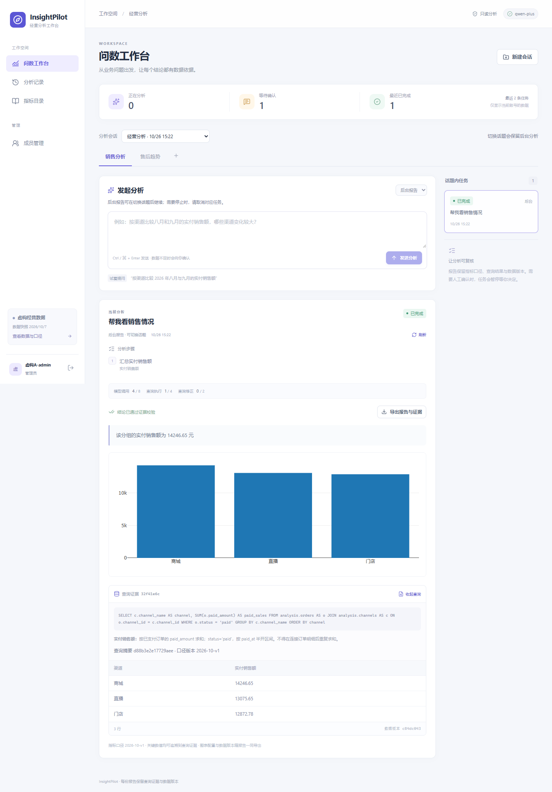

# InsightPilot · 可追溯的经营问数 Agent

[](https://github.com/cz2211262357-creator/insightpilot-agent/actions/workflows/verify.yml)

用自然语言分析电商销售与售后数据，查看查询依据、图表和可导出的证据。模糊问题先确认口径，高成本 SQL 暂停等待批准；后台分析在切换话题后继续，旧 Worker 恢复后也不能覆盖新结果。

这是一个独立运行的 Python Agent 项目。对话模型通过真实百炼兼容 API 调用，LangGraph 负责规划、执行、澄清和检查点恢复，MCP 提供受权限约束的数据工具。内置经营数据全部由固定种子生成，用于可重复验收，不含真实客户数据。

## 界面与评测



界面截图来自合成数据和控制供应商的浏览器回归；[人工澄清界面](docs/images/clarification.png)展示用户确认后继续分析的流程。

20 题真实百炼评测中，优化前后完整流程通过分别为 **0/20、16/20**，证据严格匹配分别为 **2/20、19/20**。这是参与过优化的小型固定测试集，不能代表未见问题的准确率；响应耗时和 Token 使用也有所增加。指标定义、失败案例及边界见[评测协议](docs/evaluation.md)。

## 技术与业务

| 部分 | 实现 |
| --- | --- |
| 前端 | React、TypeScript、TanStack Query、Plotly、SSE 与轮询恢复 |
| Agent | Python 3.12、FastAPI、LangGraph、langchain-openai、百炼 qwen-plus |
| 工具 | 官方 MCP Streamable HTTP SDK，四个只读数据工具，短时服务令牌 |
| 数据 | PostgreSQL 18、独立角色与 RLS、官方 Postgres Checkpointer、SQLGlot |
| 执行 | PostgreSQL 持久任务状态、租约与 fencing、Redis 原子并发准入 |
| 交付 | uv/npm 锁文件、Docker Compose、真实依赖测试、20 题评测、GitHub Actions |

支持实付销售额、净销售额、支付订单数、退款额、售后申请率、平均处理时长，覆盖渠道、地区、品类、商品和日期分析。用户可查看任务计划、消耗的调用预算、查询参数、数据版本及证据哈希。

## 运行

Windows 上安装 Docker Desktop 后，在项目目录执行：

```powershell
# R 可以是本仓库目录，也可以是包含本仓库的工作区目录；必须使用绝对路径。
$R = (Get-Location).Path
./scripts/bootstrap.ps1 -WorkspaceRoot $R
# 在 R/.env.insightpilot 填入自己的百炼 MODEL_API_KEY；不要提交这个文件。
./scripts/up.ps1 -WorkspaceRoot $R
```

访问 [本地工作台](http://localhost:8090)。首次初始化会将随机生成的租户账号保存在 `R/.data/insightpilot/accounts.json`，账号密码不会写入 README 或日志。重复初始化保留原账号。

Linux/macOS、账号管理、停启、备份恢复、部署边界见 [操作手册](docs/operations.md)。源码、工具、依赖缓存及持久数据均按工作区配置；Docker 引擎自身的镜像存储独立于项目目录，不会修改用户全局 Docker 存储设置。

## 关键设计

- **有界 Agent**：每轮最多 8 次模型调用、4 次查询、2 次 SQL 修复；后台累计执行 300 秒，人工等待另设期限。
- **数据库是最终授权点**：工具调用、检查点写入和结果提交均重新校验用户、数据版本、任务版本与租约；Redis 通知丢失不改变持久状态。
- **受控 SQL**：单条只读 SELECT、视图与函数白名单、递归 AST 校验、参数绑定、RLS；单次查询 3 秒、最多 1000 行和 1 MiB。
- **资源隔离**：执行和模型调用分别全局最多 2 个，后台最多 1 个，保留前台交互容量。
- **证据报告**：金额按 Decimal 校验，图表来自持久化查询结果，空值不替换成零，LIMIT 子查询也会提示结果不完整。
- **人工确认绑定原任务**：普通聊天中的“同意”不能批准查询；确认绑定用户、SQL、任务版本、检查点和预算。

## 验证与阅读

```powershell
. ./scripts/env.ps1 -WorkspaceRoot $R
uv run pytest -q
uv run python -m evals.run --mode controlled --report "$R/.cache/controlled.json"
# 启动 Compose 并配置真实模型后，使用预声明的合成问题及澄清回答评测：
uv run python -m evals.run --mode online --report "$R/.cache/online.json"
```

[架构与状态机制](docs/architecture.md) · [评测方法与实测结果](docs/evaluation.md) · [源码导读](docs/key-source-walkthrough.md) · [HTTP 契约](docs/contracts.md) · [MCP 协议](docs/mcp-protocol.md)

控制模式验证完整工程链路，不代表模型准确率；线上模式记录实际模型名称、输入输出 Token、失败原因和耗时。20 题仅覆盖固定合成数据上的有限场景，不代表所有业务问题的泛化能力。当前并发值是可验证的初始资源配额，没有宣称生产流量规模或通用高并发 SLA。

相关项目：[ServiceHub AI — Spring Boot 电商售后客服](https://github.com/cz2211262357-creator/servicehub-ai)。
