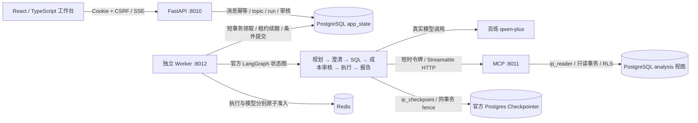

# 架构与一致性

这是 Web、API、Worker、MCP、PostgreSQL、Redis 六个独立 Compose 服务。API 只接收持久任务；Worker 从 PostgreSQL 领取，使用 Redis 约束执行容量。Agent 项目未引入 RabbitMQ，ServiceHub Java 项目中的 Outbox/RabbitMQ 属于另一个系统。

## 任务和话题

conversation 标识整个会话，topic 隔离逻辑话题，epoch 单调递增并约束前台结果。run 与 thread 一对一且不可复用，task_revision 标识任务修订，execution_version 是每次领取递增的 fencing token。

消息唯一键为 `(tenant_id, conversation_id, client_message_id)`。事务内先查重复，再对新消息执行 expected_epoch 比较和状态变更。完全相同的重试返回原 receipt，不再次推进 epoch；同键不同内容返回 409。A→B→A 后旧 A 的 epoch 不再匹配，前端也会过滤旧流事件。

| 当前状态 | 事件 | 下一状态 |
| --- | --- | --- |
| QUEUED | 获得资源且数据库领取成功 | RUNNING |
| RUNNING | 澄清或高成本查询中断并保存 checkpoint | WAITING_INPUT |
| WAITING_INPUT | 专用确认接口通过绑定校验 | QUEUED |
| RUNNING | 校验后提交完整证据报告 | SUCCEEDED |
| RUNNING | 可重试依赖失败且预算剩余 | QUEUED |
| 活跃状态 | 明确取消 / 修改 / 超时 / 撤权 | CANCELLED / SUPERSEDED / TIMED_OUT / FAILED |

成功、失败、取消、被替换和超时都是终态。自动执行共最多三次，前两次失败后分别退避 5 秒、30 秒；人工恢复不增加自动尝试次数。Worker 租约 60 秒，每 10 秒续约。恢复沿用同一个 thread、持久预算和剩余累计时间，数据库提交必须匹配当前 execution_version。

前台结果还要求当前 topic 和 epoch；后台任务只要求自身 topic、任务未取消、授权及租约仍有效。切换话题不会丢弃合法的后台报告。上下文只读取同 topic、同数据版本的已成功任务消息，最多 20 条/16000 字符；被取消、未完成的分片不进入后续上下文。

## 授权与检查点

API、MCP、Worker 不拥有 PostgreSQL 管理员凭证。状态、checkpoint、查询分别使用 `ip_state`、`ip_checkpoint`、`ip_reader`。只有维护脚本初始化 schema 与官方 saver 表。业务底表强制 RLS，查询账号只使用 analysis 视图，租户与数据版本通过事务局部配置传入，连接归还后清空。

检查点 writer 在同一个连接和事务中锁定当前身份、run，检查租约和预算，调用官方 Postgres saver，再更新 checkpoint 摘要；不存在“检查通过后换连接提交”的窗口。角色/启用状态变化推进 auth_version，旧 Cookie、MCP token 和确认不能继续使用。高成本审核绑定 SQL 哈希、预算、checkpoint、版本和期限，不能跨话题借用。

系统关闭整轮 LangGraph 的环境继承 LangSmith 导出，业务数据不会因宿主机设置自动发往跟踪服务。数据库只保存公开计划、SQL、工具结果、预算和执行事件，不保存模型思维链。Token 记录保留供应商缺失字段为空，并区分请求模型别名和实际返回模型名称。

## 时间和数值

时间点使用 UTC-aware datetime / TIMESTAMPTZ；业务日期按 Asia/Shanghai 的半开区间。金额使用 NUMERIC(18,2)/Decimal，展示按 HALF_UP；JSON 使用十进制字符串。模型不能自由填写报告数值：每个结论绑定 evidence_id、列和行，发布前重新读取并校验实际证据、SQL 策略及数据可见性。部分结果不能计算为全量总额或总体占比。
